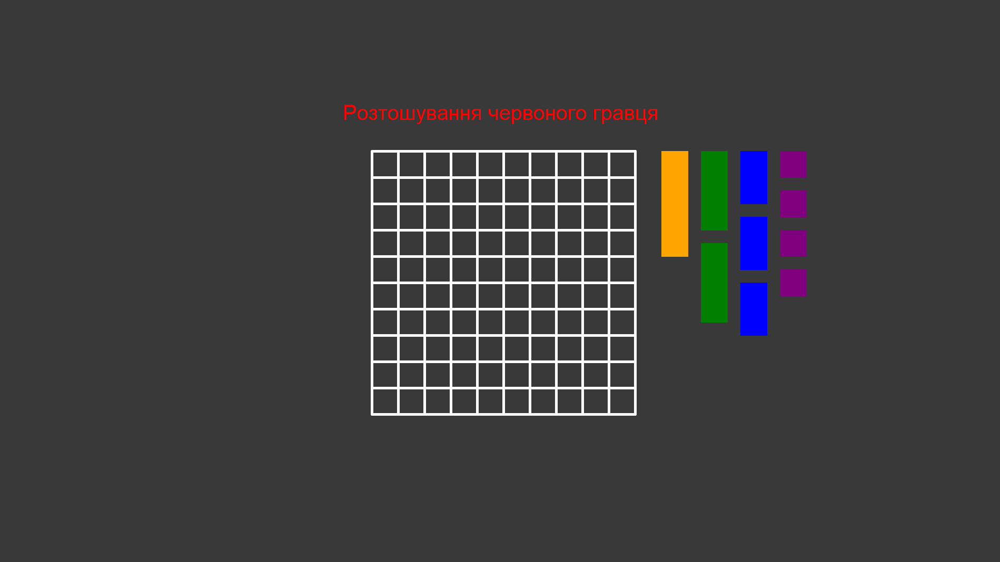

# Морський бій.
---

**«Морський бій» — це класична логічна гра для двох гравців, у якій учасники намагаються першими потопити всі кораблі суперника, називаючи координати на прихованому полі**
---


***

***


## Зміст
- [Про гру](#про-гру)
- [Правила](#правила)
- [Можливості](#можливості)
- [Технології](#технології)
- [Встановлення](#встановлення)
- [Запуск](#запуск)
- [Як грати](#як-грати)
- [Структура проєкту](#структура-проєкту)

---
## Про гру.
**«Морський бій» — гра для двох гравців (людина проти людини), у якій потрібно першим потопити всі кораблі суперника на прихованому полі 10×10.**
---

## Правила
- Поле 10×10
- Кожен гравець розставляє флот:
  - 1 чотирипалубний корабель
  - 2 трипалубні
  - 3 двопалубні
  - 4 однопалубні
- Кораблі не можуть торкатися один одного, навіть по діагоналі.
- Гравці стріляють по черзі, нажимаючі на клітинку
- Влучив — стріляєш ще раз, схибив — хід переходить до суперника.
- Виграє той, хто першим потопить усі кораблі суперника.
---

## Технології
- Python
- Turtle
---

## Можливості
- Гра проти людини
- Ручна розстановка кораблів
- Відображення двох полів: свого та поля суперника
- Позначки влучань, промахів і потоплених кораблів
- Перевірка коректності ходів і розстановки
---


## Встановлення. 
- *Встановіть Python*
- *Встановіть GitBush Terminal*
```bash
git clone https://github.com/cherkezartem/Sea-Fight
cd Sea-Fight
pip install Turtle
```
---
## Запуск 
- **Відкрийте репозиторій, два раза клікніть по файлу main.py**
---


## Як грати
1. Запустіть гру.
2. Розставте кораблі вручну.
3. Виберіть клітинку для пострілу.
4. Дивіться результат на полі суперника:
   - `X` — влучання
   - `•` — промах
5. Продовжуйте, поки не потопите всі кораблі суперника.
---

## Структура проєкту 
```
Sea_Fight/
|--- docs/
|--- modules/
|--- main.py
|--- README.md